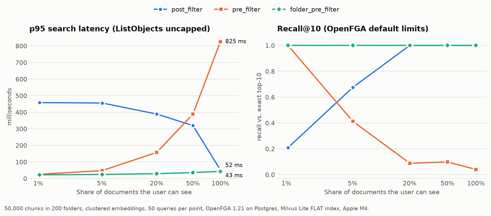

# permission-aware-rag

RAG retrieval that never shows a user a document they aren't allowed to open. Permissions live in
[OpenFGA](https://openfga.dev), embeddings in [Milvus](https://milvus.io), and answers are generated
with LangChain and a local Ollama model. The same answers are served to other agents over
[A2A](https://a2a-protocol.org) (Agent2Agent protocol), still limited to what the end user may see.

The repo implements three ways to combine permission checks with vector search and benchmarks them
on 50,000 chunks. The main finding: filtering on **folders** instead of documents gave exact results
for every user in under 45 ms at p95, while the two standard approaches either got slow or silently
lost results.



## The problem

A plain RAG pipeline retrieves whatever is most similar to the question, regardless of who is asking.
If the finance budget is the best match, an engineer's question can be answered from it. The model
never needs to show the document for the content to leak.

The fix is to apply the user's permissions during retrieval. OpenFGA's
[RAG authorization guide](https://openfga.dev/docs/modeling/agents/rag-authorization) describes two
patterns. This repo implements both plus a third, and measures where each one breaks.

## Authorization model

```
type folder
  relations
    define viewer: [user, team#member, organization#member]

type document
  relations
    define parent: [folder]
    define direct_viewer: [user, team#member]
    define viewer: direct_viewer or viewer from parent
```

Full model in [`model.fga`](model.fga). A user can see a document if they can see its folder (directly,
through a team, or through the organization), or if the document was shared with them directly.

## Three strategies

| Strategy | How it works | Cost grows with |
|---|---|---|
| `post_filter` | Vector search for `k × 4` candidates, drop the ones the user can't see with `BatchCheck`, search deeper (up to 1,000 candidates) if fewer than `k` remain. | How *little* the user can see |
| `pre_filter` | `ListObjects(user, viewer, document)`, then vector search restricted to `id in [...]`. | How *much* the user can see |
| `folder_pre_filter` | `ListObjects` for the folders the user can see and for documents shared directly (in parallel), then filter on `folder_id in [...] or id in [...]`. | Number of folders |

`folder_pre_filter` works because `viewer` is defined as `direct_viewer or viewer from parent`, so the
set of visible documents is exactly "documents in visible folders, plus direct shares". Each chunk stores
its `folder_id` in Milvus to make that filter possible. Implementation:
[`src/parag/retriever.py`](src/parag/retriever.py).

## Results

50,000 chunks in 200 folders, 384-dimensional embeddings, 50 queries per user, k = 10. Five users can
see 1%, 5%, 20%, 50% and 100% of the documents (plus 20 direct shares each). Recall is measured
against the exact top-10 among the documents that user may see. Every result is also checked
for leaks.

**OpenFGA with `ListObjects` uncapped** (clustered embeddings):

| user can see | strategy | p50 ms | p95 ms | recall@10 | candidates checked | IDs listed |
|---:|---|---:|---:|---:|---:|---:|
| 1% | post_filter | 445.0 | 458.0 | **0.208** | 947 | – |
| 1% | pre_filter | 24.4 | 25.7 | 1.000 | – | 520 |
| 1% | folder_pre_filter | 21.5 | 22.2 | 1.000 | – | 22 |
| 5% | post_filter | 425.1 | 455.6 | **0.676** | 842 | – |
| 5% | pre_filter | 38.2 | 47.7 | 1.000 | – | 2,520 |
| 5% | folder_pre_filter | 22.9 | 24.4 | 1.000 | – | 30 |
| 20% | post_filter | 282.5 | 388.9 | 1.000 | 542 | – |
| 20% | pre_filter | 88.8 | 157.7 | 1.000 | – | 10,020 |
| 20% | folder_pre_filter | 26.6 | 29.2 | 1.000 | – | 60 |
| 50% | post_filter | 275.4 | 319.2 | 1.000 | 376 | – |
| 50% | pre_filter | 272.5 | 388.4 | 1.000 | – | 25,020 |
| 50% | folder_pre_filter | 33.5 | 35.8 | 1.000 | – | 120 |
| 100% | post_filter | 50.3 | 52.2 | 1.000 | 40 | – |
| 100% | pre_filter | 491.9 | **825.3** | 1.000 | – | 50,000 |
| 100% | folder_pre_filter | 41.6 | 43.1 | 1.000 | – | 200 |

All runs: [`bench/results/`](bench/results/).

### What the numbers say

1. **`pre_filter` silently loses results under OpenFGA's defaults.** `ListObjects` returns at most
   1,000 objects by default (`--listObjects-max-results`), with no error when it truncates. Any user
   who can see more than 1,000 documents gets an arbitrary 1,000 of them, and recall fell to 0.41 at
   5% access and 0.04 at 100% ([default-limits run](bench/results/default-limits-clustered.md)).
   Removing the cap fixes recall, but p95 latency climbs to 825 ms when the user can see all 50,000
   documents.
2. **`post_filter` fails users who can see little.** At 1% access it checked about 950 candidates,
   took 445 ms, and still found only 21% of the correct results. Topic clustering makes this
   worse. With uniformly random embeddings the same user got 0.90 recall
   ([uniform run](bench/results/default-limits-uniform.md)), because in the clustered data the
   nearest neighbours of a question usually sit in a folder the user can't open.
3. **`folder_pre_filter` stayed exact and flat.** It needs only 22–200 IDs from OpenFGA instead of
   up to 50,000. Compared with `pre_filter`, p95 is 95% lower at full access (43 ms vs 825 ms).
   Compared with `post_filter`, it's 20× faster at 1% access with full recall.
4. **No leaks.** None of the 2,250 benchmark searches returned a document the user couldn't see. A
   sample of every run is re-checked against OpenFGA itself.

### When `folder_pre_filter` does not apply

- **It depends on the model's shape.** If `viewer` gains an exclusion (`but not blocked`) or a condition,
  "visible folder ⇒ visible document" is no longer true. You then need to run `BatchCheck` on the
  final `k` results, or fall back to `post_filter`.
- **`folder_id` is a denormalized copy** of the `parent` tuple. Moving a document means updating both
  OpenFGA and Milvus.
- **Very large folder counts** hit the same `ListObjects` cap. The same trade-off returns one level up.

## Use it from another agent (A2A)

The API also runs an A2A agent, built with the official [`a2a-sdk`](https://pypi.org/project/a2a-sdk/):

- Agent card: `GET /.well-known/agent-card.json` (one skill, `ask_documents`)
- JSON-RPC endpoint: `POST /a2a`, method `SendMessage`

The reply is a message with the answer as text and the documents used as a data part. The end user
comes from the request's identity (the `X-User` header in this demo, declared in the agent card),
never from the message text or metadata. A calling agent can't get someone else's documents by
writing "answer as bob", and IDs like `team:finance#member` are rejected. A real deployment should
take the user from a verified token, for example an OAuth token the calling agent obtained for that
user through token exchange.

```bash
curl -s localhost:8000/a2a -H 'Content-Type: application/json' -H 'A2A-Version: 1.0' -H 'X-User: bob' -d '{
  "jsonrpc": "2.0", "id": "1", "method": "SendMessage",
  "params": {"message": {"role": "ROLE_USER", "messageId": "m1",
             "parts": [{"text": "What is the approved budget for Project Falcon?"}]}}}'
```

With the demo corpus, bob (finance) and erin (an engineer the budget was shared with) get
*"The approved budget for Project Falcon is USD 2.4M for FY2027 [doc 21]"* with
`{"sources": ["document:21", ...]}`. Alice (engineering) gets *"I could not find that in the documents
available to you."* Set `OLLAMA_MODEL=none` to return the permitted passages instead of an LLM answer,
which suits a calling agent that writes the answer with its own model.

## Run it

Requirements: Python 3.11+, an OpenFGA server, and optionally [Ollama](https://ollama.com) for answer
generation.

```bash
# OpenFGA + Postgres
docker compose up -d
# or, without Docker: brew install openfga && openfga run

python -m venv .venv && source .venv/bin/activate
pip install -e ".[dev]"

pytest                                    # 22 tests; all but the A2A unit tests need OpenFGA on :8080
python demo/run_demo.py --ask             # demo corpus; --ask needs `ollama pull llama3.1:8b`
uvicorn parag.api:app                     # POST /search, /ask and A2A at /a2a; user in the X-User header
python bench/run_benchmark.py --label default-limits --distribution clustered
python bench/plot_results.py
```

The demo uses a fictional company with five users. Asked *"What is the approved budget for Project
Falcon?"*, the finance user gets the figure. An engineer gets *"I could not find that in the documents
available to you."* Erin, an engineer the budget was shared with directly, gets the figure.

The API takes the user from an `X-User` header to keep the demo simple. A real deployment must take
it from a verified token.

## Layout

```
model.fga                  OpenFGA authorization model
src/parag/authz.py         OpenFGA client: store bootstrap, tuples, Check, BatchCheck, ListObjects
src/parag/store.py         Milvus collection (FLAT index, INVERTED index on folder_id)
src/parag/retriever.py     the three strategies
src/parag/rag.py           LangChain retriever, embeddings (fastembed), RAG chain
src/parag/api.py           FastAPI service
src/parag/a2a_agent.py     A2A agent: agent card, JSON-RPC endpoint, end-user identity
src/parag/synthetic.py     synthetic org with known ground truth
bench/                     benchmark, chart, results
demo/                      demo corpus and script
tests/                     leak, exactness, direct-share, revocation and A2A tests
```

## Benchmark caveats

- **One machine (Apple M4)**, with OpenFGA 1.21 on a local Postgres 14 and Milvus Lite with an exact
  FLAT index. Absolute numbers will differ on a networked deployment. The relative shape is the point.
- **Synthetic data.** Embeddings are random vectors, either uniform or clustered by folder. This
  isolates the authorization behaviour from embedding quality.
- **`post_filter` parameters.** It uses an over-fetch factor of 4 and a 1,000-candidate ceiling.
  Raising the ceiling trades latency for recall. It can't make the 1% case both fast and exact.

## License

MIT
